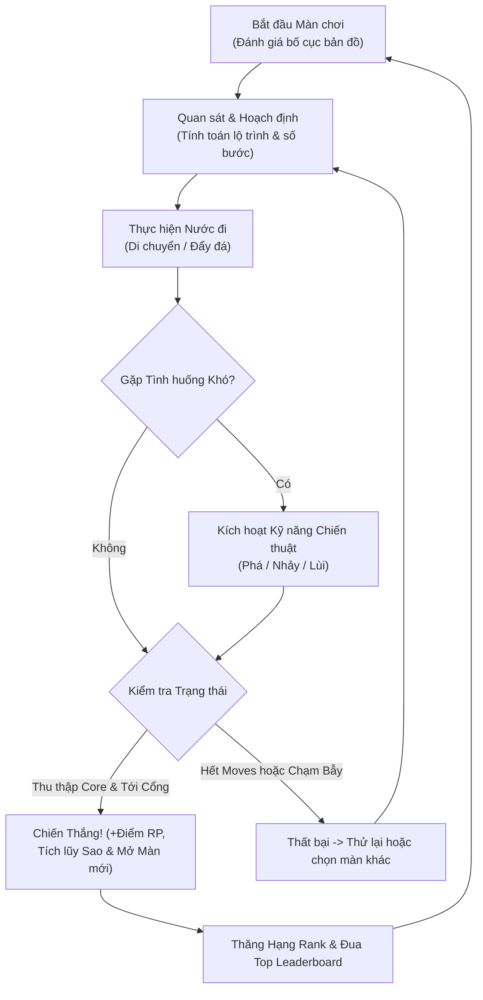

# GAME DESIGN DOCUMENT (GDD)
## Tên dự án: CHRONO GRID: AETHER PROTOCOL
**Thể loại:** 2D Grid-based Puzzle / Strategic Turn-based  
**Nền tảng mục tiêu:** PC (Web/Desktop), Mobile (iOS/Android), Tablet  
**Kiến trúc:** HTML5 Canvas, Web Audio API, Modular Vanilla JavaScript, CSS3  
**Phiên bản:** 2.0 (Hỗ trợ Auth Google/Khách, Rank Leaderboard, 10 Màn Chơi)  

---

## 1. Ý TƯỞNG CỐT LÕI (CORE CONCEPT)

### 1.1. Bối cảnh & Mục tiêu (Lore & Objective)
- **Bối cảnh:** Trong trạm không gian phân rã lượng tử *The Fractured Void*, bạn là Robot thám hiểm lượng tử **A.E.T.H.E.R**. Mỗi bước di chuyển tiêu tốn năng lượng phản vật chất.
- **Mục tiêu:** Thu thập toàn bộ **Lõi Năng Lượng (Energy Cores)** trên bản đồ và tiến vào **Cổng Dịch Chuyển (Warp Portal)** trước khi cạn kiệt số bước (Moves).

### 1.2. Vòng lặp Gameplay Chính (Core Gameplay Loop)

---

## 2. HỆ THỐNG LUẬT CHƠI (RULES & MECHANICS)

### 2.1. Luật Cơ Bản
- **Di chuyển lưới:** 4 hướng trực giao (Lên, Xuống, Trái, Phải). Mỗi bước di chuyển tiêu tốn 1 Move.
- **Khối đá (Pushable Block):** Đẩy được 1 khối nếu ô kế tiếp sau khối đá là ô trống. Nếu đẩy khối đá vào ô Bẫy gai, bẫy sẽ bị **vô hiệu hóa vĩnh viễn** thành cầu an toàn.
- **Lõi Năng Lượng (Energy Core):** Phải nhặt đủ 100% trong màn để kích hoạt Cổng Dịch Chuyển.
- **Cổng Dịch Chuyển (Warp Portal):** Kích hoạt hào quang xanh khi đủ Cores.

### 2.2. Điều Kiện Thắng / Thua & Đánh Giá Sao
- **Thắng:** Đủ Cores + tới Portal khi Moves $\ge 0$.
- **Thất bại:** Hết Moves hoặc bước vào bẫy gai chưa vô hiệu hóa.
- **Đánh giá Sao (1 - 3 Sao):** Dựa trên số bước còn lại so với mốc tối ưu của từng màn.

---

## 3. HỆ THỐNG KỸ NĂNG (SKILLS)
1. **💥 Phá Hủy (Break):** Phá vỡ ngay 1 khối đá trước mặt (1 lần/màn).
2. **⚡ Nhảy Vọt (Jump):** Nhảy qua 1 ô bẫy hoặc vật cản và đáp an toàn (2 lần/màn).
3. **⏪ Quay Lui (Undo):** Hoàn tác toàn bộ trạng thái về 1 bước trước đó (3 lần/màn).

---

## 4. HỆ THỐNG TÀI KHOẢN & XẾP HẠNG (AUTH & RANKING)

### 4.1. Xác Thực Người Chơi (Authentication)
- **Đăng nhập bằng Gmail:** Nhập địa chỉ Gmail để định danh người chơi, lưu trữ thành tích và điểm rank lâu dài.
- **Tài khoản Khách (Guest Account):** Tạo tức thì 1-click cho người chơi thử nghiệm, hỗ trợ đổi tên hiển thị bất cứ lúc nào.

### 4.2. Cấp Bậc Rank (Rank Tiers)
$$\text{Điểm Rank (RP)} = 100\text{ (Qua Màn)} + 50 \times \text{Số Sao} + 5 \times \text{Số Bước Dư}$$

| Cấp Bậc | Badge | Mức Điểm (RP) | Đặc quyền |
| :--- | :---: | :---: | :--- |
| **Tập Sự (Bronze)** | 🥉 | 0 - 299 RP | Mở khóa 3 màn đầu |
| **Chiến Binh (Silver)** | 🥈 | 300 - 699 RP | Mở khóa danh hiệu Chiến Binh |
| **Bậc Thầy (Gold)** | 🥇 | 700 - 1199 RP | Vinh danh trong Top 10 |
| **Huyền Thoại (Diamond)** | 💎 | 1200 - 1799 RP | Khung viền lượng tử sáng |
| **Siêu Việt (Aether Legend)** | 🌌 | 1800+ RP | Danh hiệu tối cao vũ trụ Aether |

### 4.3. Bảng Xếp Hạng (Leaderboard)
- Giao diện tra cứu thứ hạng thời gian thực.
- Xử lý trọn vẹn 3 trạng thái bất đồng bộ: **Loading** (vòng xoay), **Error** (thông báo lỗi và nút thử lại) và **Success** (hiển thị danh sách top điểm).

---

## 5. THIẾT KẾ 10 MÀN CHƠI (LEVEL PROGRESSION)

| Màn | Tên Màn | Kích Thước | Moves | Cores | Điểm Nhấn Chiến Thuật |
| :---: | :--- | :---: | :---: | :---: | :--- |
| **1** | Khởi Động Lưới | 7x7 | 16 | 2 | Làm quen di chuyển, nhặt Core và đẩy 1 khối đá mở đường. |
| **2** | Đẩy Đá Lượng Tử | 7x7 | 16 | 2 | Phối hợp 2 khối đá để mở đường hầm ziczac. |
| **3** | Rãnh Bẫy Gai | 8x8 | 18 | 2 | Đẩy đá lấp hàng bẫy gai tạo cầu đi qua khu vực đích. |
| **4** | Nhảy Vọt Lượng Tử | 8x8 | 16 | 2 | Sử dụng kỹ năng Jump vượt qua bẫy chông tiết kiệm bước. |
| **5** | Phá Hủy Chướng Ngại | 8x8 | 18 | 2 | Dùng kỹ năng Break phá đá bị mắc kẹt trong góc cụt. |
| **6** | Nút Thắt Đôi | 8x8 | 20 | 2 | Kết hợp cả kỹ năng Nhảy và Phá hủy trong không gian hẹp. |
| **7** | Mê Cung Nghịch Đảo | 9x9 | 26 | 2 | Thử thách đảo ngược thời gian (Undo) khi di chuyển sai bước. |
| **8** | Trận Địa Gai Liên Hoàn | 9x9 | 24 | 3 | Thu thập 3 lõi giữa trận địa bẫy chông đối xứng. |
| **9** | Hốc Tường Phản Vật Chất | 9x9 | 28 | 4 | 4 Lõi phân tán tại 4 góc, rủi ro góc chết Sokoban cao. |
| **10** | Giao Thức Aether Tối Thượng | 9x9 | 30 | 4 | Đỉnh cao thử thách: phối hợp toàn bộ kỹ năng để giải câu đố. |
