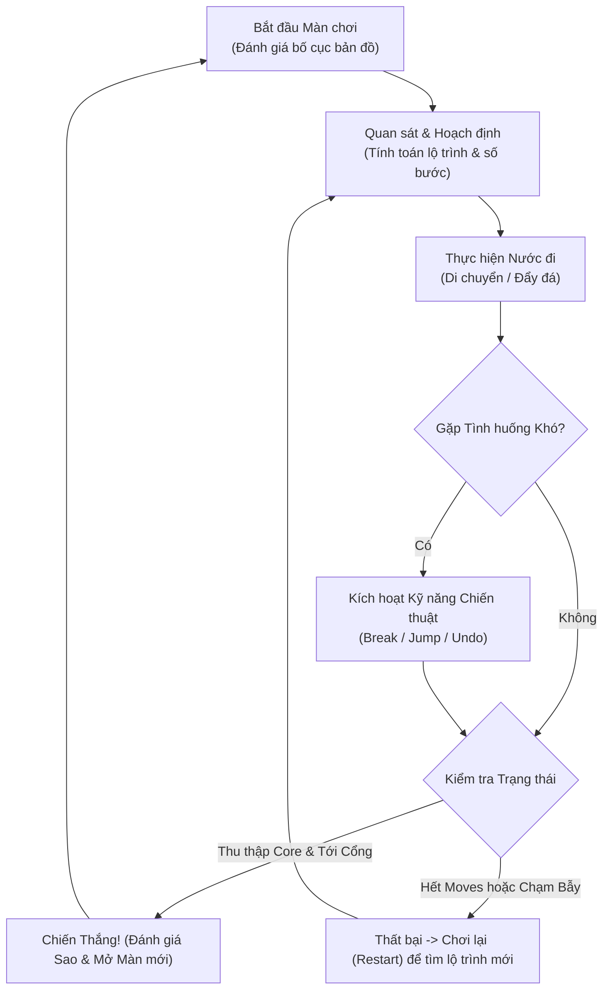

# GAME DESIGN DOCUMENT (GDD)
## Tên dự án: CHRONO GRID: AETHER PROTOCOL
**Thể loại:** 2D Grid-based Puzzle / Strategic Turn-based  
**Nền tảng mục tiêu:** PC (Web/Desktop), Mobile (iOS/Android), Tablet  
**Công nghệ triển khai mẫu:** HTML5 Canvas, Vanilla JavaScript, CSS3  
**Tác giả:** Senior Game Designer  

---

## 1. Ý TƯỞNG CỐT LÕI (CORE CONCEPT)

### 1.1. Bối cảnh & Mục tiêu (Lore & Objective)
- **Bối cảnh:** Trong một trạm thí nghiệm không gian cổ đại bị sụp đổ chiều không gian (*The Fractured Void*), bạn vào vai một Robot thám hiểm lượng tử mang mã hiệu **A.E.T.H.E.R**. Trạm năng lượng đang sụp đổ dần sau mỗi nhịp vận hành.
- **Mục tiêu:** Thu thập đủ **Lõi Năng Lượng (Energy Cores)** rải rác trên sàn trạm và tiến đến **Cổng Dịch Chuyển (Warp Portal)** trước khi nguồn năng lượng bước đi (Moves) cạn kiệt, đồng thời né tránh các bẫy chết chóc và mở khóa các lối đi bị phong tỏa.

### 1.2. Vòng lặp Gameplay Chính (Core Gameplay Loop)

---

## 2. HỆ THỐNG LUẬT CHƠI (RULES & MECHANICS)

### 2.1. Luật Cơ Bản (Core Rules)
- **Cơ chế Không gian:** Bản đồ được cấu trúc dạng lưới ô vuông (Square Grid). Nhân vật chỉ di chuyển theo 4 hướng trực giao (Lên, Xuống, Trái, Phải).
- **Cơ chế Theo Lượt (Turn-based / Discrete Steps):** 
  - Mỗi thao tác di chuyển hợp lệ của nhân vật tiêu tốn chính xác **1 Bước đi (1 Move)**.
  - Các tương tác với môi trường diễn ra tức thì tại ô đích.
- **Tương tác Vật thể:**
  - **Tường cứng (Impassable Wall):** Chặn mọi chuyển động thông thường.
  - **Khối đá lượng tử (Pushable Crate):** Người chơi có thể đẩy khối đá nếu ô kế tiếp sau khối đá theo hướng đẩy là ô trống. Không thể kéo đá.
  - **Bẫy Điện/Gai (Traps):** Ô nguy hiểm chết người. Nếu người chơi bước vào sẽ bị quá tải năng lượng (Thua ngay lập tức). Tuy nhiên, khối đá có thể được đẩy đè lên bẫy để vô hiệu hóa bẫy vĩnh viễn.
  - **Lõi Năng Lượng (Energy Cores):** Vật phẩm bắt buộc phải nhặt hết 100% trong màn để kích hoạt Cổng Dịch Chuyển.
  - **Cổng Dịch Chuyển (Warp Portal):** Ở trạng thái Khóa (Màu cam/tắt hào quang) khi chưa đủ Core; chuyển sang trạng thái Kích hoạt (Màu xanh xoáy hào quang) khi đã đủ Core.

### 2.2. Giới Hạn & Áp Lực (Constraints)
- **Giới hạn Nước đi (Strict Move Limit):** Mỗi màn chơi được cấp một hạn mức di chuyển cụ thể (ví dụ: 18 bước). Mỗi bước đi trừ 1 vào bộ đếm. Nếu bộ đếm về 0 mà nhân vật chưa đứng tại Cổng Dịch Chuyển hợp lệ $\rightarrow$ **Thất Bại (Out of Energy)**.
- **Giới hạn Kỹ năng (Limited Skill Charges):** Kỹ năng hỗ trợ không hồi theo thời gian mà có số lần dùng cố định cho từng màn chơi, buộc người chơi phải cân nhắc kỹ năng như một loại "tài sản chiến lược".

### 2.3. Điều Kiện Thắng / Thua (Win / Loss Conditions)
| Điều kiện | Tiêu chí kích hoạt | Kết quả |
| :--- | :--- | :--- |
| **Thắng (Clear Level)** | Đã nhặt đủ tất cả Energy Cores + Nhân vật bước vào ô Portal + Số Moves $\ge 0$. | Hiển thị màn hình Thắng, xếp hạng 1-3 Sao, mở màn tiếp theo. |
| **Thua do Hết Nước Đi** | Số bước còn lại = 0 nhưng chưa tới Portal hoặc chưa nhặt đủ Cores. | Màn hình Thất bại: "Out of Moves" $\rightarrow$ Thử lại. |
| **Thua do Chạm Bẫy** | Nhân vật bước thẳng vào ô Bẫy chưa bị vô hiệu hóa. | Màn hình Thất bại: "Hazard Collision" $\rightarrow$ Thử lại. |

### 2.4. Cơ Chế Tăng Độ Khó (Progression & Difficulty Curve)
- **Độ lệch tối ưu (Optimization Slack):** Ở màn đầu, số bước cho phép dư dả 20-30% so với lộ trình ngắn nhất. Ở các màn cao cấp, số bước chỉ dư đúng 1-2 bước (hoặc chính xác tuyệt đối).
- **Phức tạp hóa Không gian (Spatial Bottlenecks):** Thiết kế nút thắt cổ chai (choke points), đường một chiều, các góc chết đẩy đá (Sokoban deadlocks).
- **Kết hợp Đa cơ chế:** Phải dùng đá lấp bẫy trước mới lấy được Core phía sau, hoặc phải hy sinh kỹ năng Break để mở đường tắt tiết kiệm 4 bước đi.

---

## 3. HỆ THỐNG KỸ NĂNG (SKILLS ARCHITECTURE)

### 3.1. Kỹ Năng Trong Game (In-Game Active Skills)
Để giải quyết những bài toán hóc búa mà các thao tác đi bộ thông thường không thể vượt qua, nhân vật được trang bị bộ kỹ năng đặc biệt:

1. **Phá Hủy (Disruptor / Break):**
   - *Cách hoạt động:* Tiêu diệt ngay lập tức 1 chướng ngại vật (Khối đá đẩy) nằm ngay tại ô phía trước mặt nhân vật theo hướng đang nhìn.
   - *Giới hạn:* Tối đa **1 lần/màn**.
   - *Chiến thuật:* Dùng khi vô tình đẩy đá vào góc chết không thể kéo ra, hoặc phá đá chặn đường ngắn nhất để tiết kiệm bước đi.

2. **Nhảy Vọt Lượng Tử (Quantum Leap / Jump):**
   - *Cách hoạt động:* Nhảy vọt qua 1 ô phía trước (kể cả ô đó là Bẫy, Đá hoặc Hào rãnh) và hạ cánh an toàn xuống ô thứ 2 (với điều kiện ô thứ 2 là ô trống hợp lệ). Thao tác này tiêu tốn 1 bước đi thông thường.
   - *Giới hạn:* Tối đa **2 lần/màn**.
   - *Chiến thuật:* Băng qua dải bẫy gai mà không cần tốn công đẩy đá đi vòng vèo.

3. **Nghịch Đảo Thời Gian (Chrono Rewind / Undo):**
   - *Cách hoạt động:* Đảo ngược trạng thái toàn bộ màn chơi về đúng 1 bước trước đó (hoàn lại 1 Move, trả lại vị trí nhân vật, trạng thái đá và core).
   - *Giới hạn:* Tối đa **3 lần/màn**.
   - *Chiến thuật:* Cứu cánh cho các lỗi tính toán sai bước hoặc đi nhầm vào bẫy mà không cần phải chơi lại từ đầu màn.

4. **Kính Nhìn Không Gian (Precognition / Path Analysis - Tính năng mở rộng):**
   - *Cách hoạt động (Passive/Toggle):* Hiển thị vệt sáng mô phỏng bán kính nguy hiểm của bẫy và đánh dấu các ô góc chết (Deadlock Tiles) mà nếu đẩy đá vào đó sẽ không thể di chuyển được nữa.

### 3.2. Kỹ Năng Nhận Thức Người Chơi (Player Cognitive Skills)
1. **Tư duy Không gian & Dự phóng Hình học (Spatial Reasoning):** Khả năng xoay chuyển vị trí các khối vật thể trong tâm trí trước khi chạm tay vào phím bấm.
2. **Quy nạp Ngược (Backward Induction):** Xuất phát từ mục tiêu cuối cùng (Cổng Dịch Chuyển) để lần ngược về vị trí hiện tại: *"Để vào được cổng cần đến từ ô A; để đến ô A cần đẩy khối đá tại ô B; để đẩy đá B cần đứng tại C..."*
3. **Quản lý Tài nguyên Căng thẳng (Resource Budgeting):** Cân đối giữa việc "Đi đường vòng tốn thêm 4 bước" hay "Dùng 1 lượt Jump để tiết kiệm bước cho đoạn sau".
4. **Kiểm soát Sai số & Phân tích Đánh đổi (Risk & Trade-off Assessment):** Nhận diện điểm không thể đảo ngược (Points of No Return) để tránh lãng phí lượt Undo.

---

## 4. TỐI ƯU HÓA ĐA THIẾT BỊ (CROSS-PLATFORM DESIGN)

### 4.1. Hệ Thống Điều Khiển Đồng Nhất (Universal Control Scheme)
Trò chơi áp dụng kiến trúc trừu tượng hóa thao tác người dùng (Input Abstraction Layer):
- **Trên PC:**
  - Di chuyển: Cụm phím `WASD` hoặc 4 phím Mũi tên (`Arrow Keys`).
  - Kích hoạt kỹ năng: Phím số `1` (Break), `2` (Jump), `3` (Undo). Phím `R` để Restart màn.
  - Chuột: Có thể click trực tiếp vào các nút kỹ năng trên HUD.
- **Trên Mobile & Tablet:**
  - Thao tác Cử chỉ: Hỗ trợ **Vuốt cảm ứng (Touch Swipe)** 4 hướng bất kỳ trên màn hình với ngưỡng lọc rung ngón tay (Deadzone threshold 25px).
  - Phím ảo Trực quan (Virtual D-pad): Bố trí cụm phím điều hướng ảo 4 hướng tại góc dưới màn hình cho người chơi thích cảm giác bấm chắc chắn.
  - Nút kỹ năng: Thiết kế nút to, đường kính tối thiểu 54px (chuẩn Apple Human Interface Guidelines) nằm trong vùng ngón cái (Thumb Zone).

### 4.2. Giao Diện Người Dùng Thích Ứng (Responsive UI/UX)
- **Viewport Động:** Canvas tự động tính toán kích thước ô lưới `tileSize` dựa trên tỉ lệ màn hình thiết bị hiện tại, luôn giữ toàn bộ bản đồ hiển thị trọn vẹn ở trung tâm mà không bị che khuất.
- **Bố cục Màn hình Ngang (Landscape - PC / Tablet / iPad):**
  - Bản đồ nằm giữa trung tâm.
  - Bảng thông tin (HUD: Màn chơi, Bước đi còn lại, Số Cores) nằm ở dải trên cùng hoặc bên trái.
  - Cụm kỹ năng và nút chức năng nằm gọn gàng ở bảng điều khiển bên phải.
- **Bố cục Màn hình Dọc (Portrait - Smartphone):**
  - 15% phía trên: Thanh trạng thái HUD (Level, Moves Counter, Gems Left, Nút Restart).
  - 55% ở giữa: Bàn cờ Canvas tự động căn chỉnh vừa khít chiều ngang máy.
  - 30% phía dưới: Cụm nút kỹ năng lớn và Virtual D-pad nằm trọn vẹn trong vùng với tay của ngón cái.

---

## 5. THIẾT KẾ 3 MÀN CHƠI MẪU (LEVEL DESIGN)

### Màn 1: "Tập Huấn Lượng Tử" (Tutorial & Basics)
- **Mục tiêu sư phạm:** Giúp người chơi nắm bắt cơ chế di chuyển lưới, thu thập Core, đẩy 1 khối đá để mở đường và tiến vào Cổng mà không cần đọc văn bản hướng dẫn dài dòng.
- **Bố cục (Kích thước 7x7):**
  - Nhân vật xuất phát tại góc trái dưới `(1, 5)`.
  - Có 2 Lõi Năng Lượng: 1 lõi nằm trên đường đi tự do, 1 lõi nằm sau 1 khối đá.
  - Cổng Portal nằm tại `(5, 1)`.
  - Không có bẫy chết người.
- **Giới hạn bước:** 14 bước (Lộ trình tối ưu mất 10 bước).
- **Điểm thỏa mãn:** Người chơi cảm nhận được xúc giác đẩy đá trơn tru và nhìn thấy Cổng bừng sáng khi nhặt đủ ngọc.

### Màn 2: "Ranh Giới Bẫy Gai" (Introduction to Traps & Skills)
- **Mục tiêu sư phạm:** Giới thiệu ô Bẫy Chông chết người và hướng dẫn sử dụng kỹ năng **Jump** và **Break**.
- **Bố cục (Kích thước 8x8):**
  - Xuất hiện một hàng bẫy chia cắt bản đồ thành 2 khu vực.
  - Có 1 khối đá nằm gần rãnh bẫy: Người chơi có thể chọn đẩy đá lấp 1 ô bẫy để tạo cầu đi qua HOẶC sử dụng kỹ năng **Jump** để nhảy trực tiếp qua bẫy.
  - Ở góc bên kia, 1 khối đá khác chắn ngay trước Lõi Năng Lượng trong một hốc tường cụt. Người chơi không thể đẩy đá vào hốc tường $\rightarrow$ Bắt buộc kích hoạt kỹ năng **Break** để phá đá lấy Core.
- **Giới hạn bước:** 16 bước.

### Màn 3: "Mê Cung Nghịch Đảo" (Complex Strategy Challenge)
- **Mục tiêu sư phạm:** Thử thách tối thượng kết hợp tư duy đa chiều: Lập kế hoạch lộ trình chính xác từng bước, giải quyết góc kẹt, kết hợp Jump và Undo khi tính toán sai.
- **Bố cục (Kích thước 9x9):**
  - Mê cung tường ziczac với 3 Lõi Năng Lượng ở 3 góc xa.
  - Bẫy bố trí xen kẽ tại các ngã rẽ hiểm trở.
  - 2 Khối đá cần được đẩy theo thứ tự chính xác: Khối thứ nhất dùng để lấp bẫy mở đường sang lõi thứ 2; nếu đẩy sai hướng sẽ tự giam mình vào ngõ cụt.
  - Lộ trình đi dài và số bước bị siết chặt (24 bước cho lộ trình tối ưu 21 bước).
- **Điểm thỏa mãn:** Cảm giác "Aha!" vỡ òa khi người chơi nhìn ra được chuỗi hành động hoàn hảo từng bước một.
